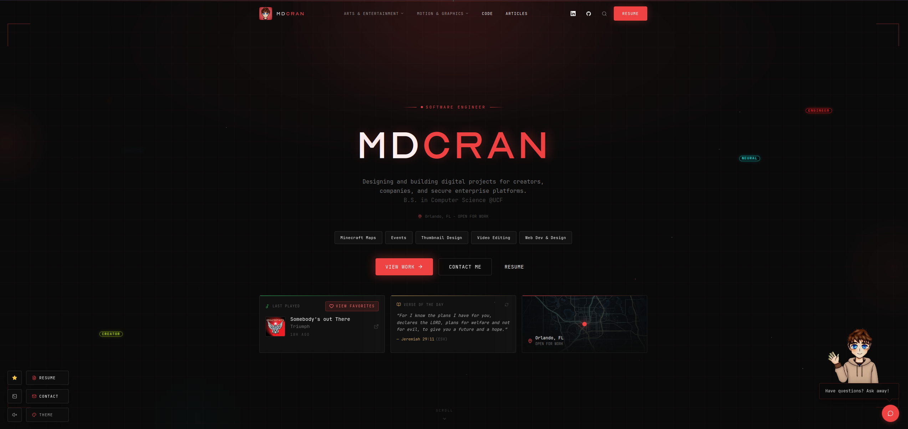
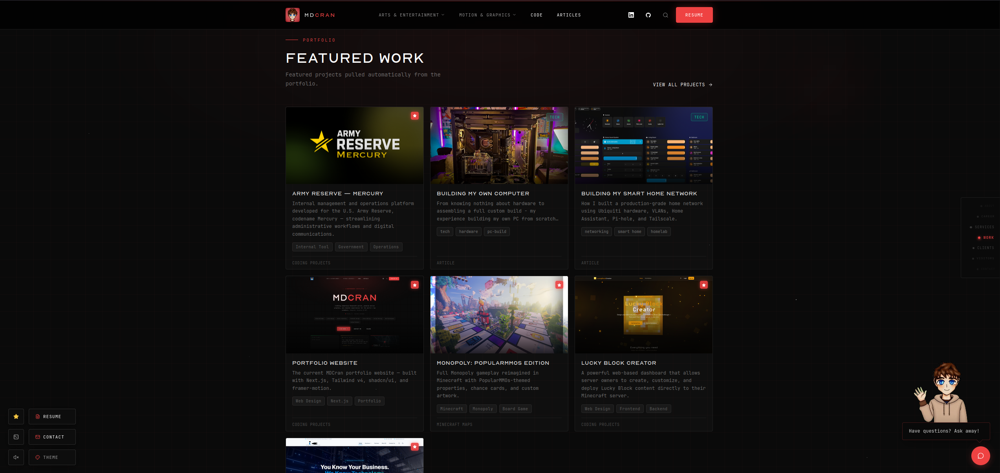
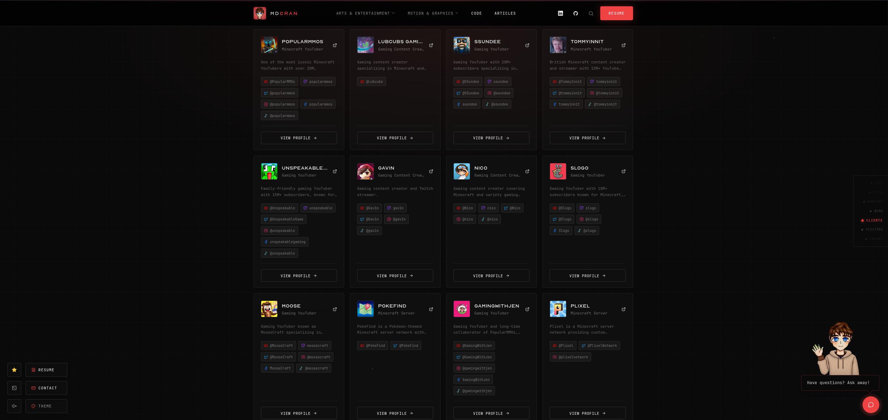
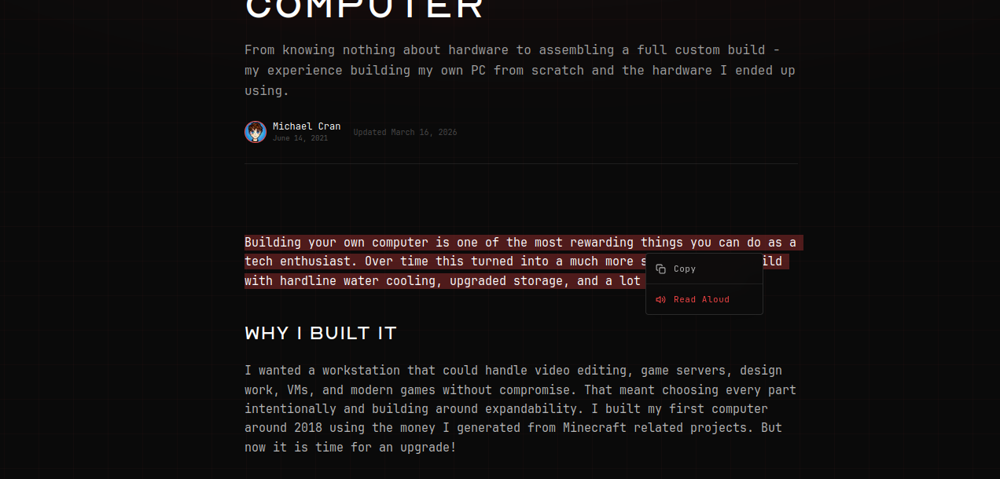
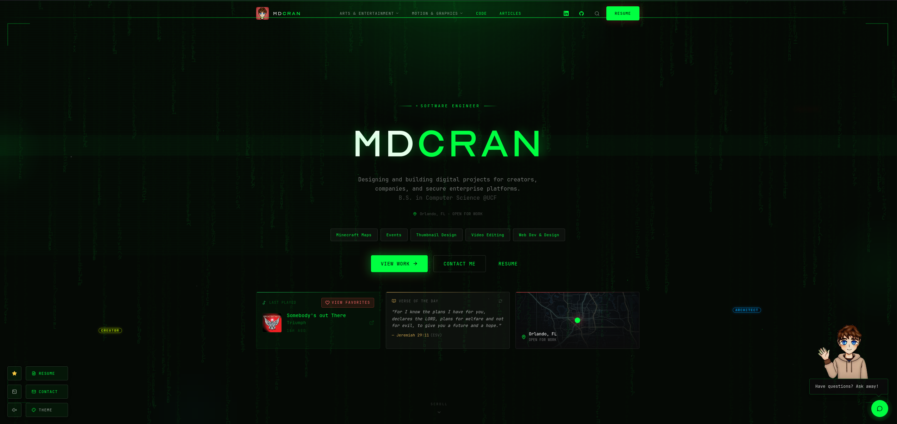

# MDCran Portfolio

[](https://github.com/MDCran/mdcran-portfolio/actions/workflows/security-checks.yml)
[](https://github.com/MDCran/mdcran-portfolio/actions/workflows/codeql.yml)

Michael Cran's personal portfolio: a full-stack Next.js application for presenting software projects, creative work, articles, and professional experience.

**[Visit the portfolio](https://mdcran.com/)** · [Application setup](web/README.md) · [Contributing](CONTRIBUTING.md)

## What to explore

- A server-rendered home page that assembles projects, articles, clients, and experience from MongoDB.
- Project and article browsing, resume and contact pages, and a content administration area.
- Reusable React interfaces, theme support, animation, and interactive experiences.
- Optional AI and voice integrations, with configuration documented in the application README.

The deployed portfolio uses separately configured data and services. A fresh checkout does not include its database contents or credentials.

## Stack

- Next.js 16 App Router, React 19, and TypeScript
- Tailwind CSS 4, Radix UI components, and Motion
- MongoDB for content persistence
- npm with a committed lockfile in `web/`

See [web/package.json](web/package.json) for exact versions and scripts.

## Run locally

Use Node.js and npm compatible with the locked dependencies. The existing dependency-check workflow uses Node.js 20.

```bash
git clone https://github.com/MDCran/mdcran-portfolio.git
cd mdcran-portfolio/web
npm ci
```

Create a git-ignored `.env.local` in this directory (`web/.env.local` relative to the repository root) with a connection to your own development MongoDB database:

```dotenv
MONGODB_URI=mongodb://127.0.0.1:27017
MONGODB_DB=mdcran_dev
```

Then run:

```bash
npm run dev
```

Open [http://localhost:4000](http://localhost:4000). The development script uses port 4000 and webpack. Configure admin authentication and any optional integrations using [web/README.md](web/README.md). Use development data and keep credentials out of Git.

## Source guide

- [web/src/app](web/src/app): pages, layouts, and API routes
- [web/src/components](web/src/components): reusable interface components
- [web/src/lib/db.ts](web/src/lib/db.ts): content access and persistence
- [web/src/lib/mongodb.ts](web/src/lib/mongodb.ts): MongoDB connection
- [web/public](web/public): static assets
- [docs/screenshots](docs/screenshots): captured application views

## Quality and security checks

From `web/`, `npm run lint` runs ESLint and `npm run build` creates the production build.

- [CodeQL](.github/workflows/codeql.yml) analyzes JavaScript and TypeScript on pushes, pull requests, and a weekly schedule.
- [Security checks](.github/workflows/security-checks.yml) installs locked dependencies with lifecycle scripts disabled, runs `npm audit --audit-level=high`, and checks whitespace with `git diff --check`.
- The audit step is **non-blocking** (`continue-on-error: true`). A successful workflow can still contain dependency advisories. Review the run logs; the badge does not mean the application is vulnerability-free.
- The current workflows do not run the application build or ESLint.

## Screenshots

### Home



### Featured work



### Clients



### Article



### Theme variant



## Attribution

Built and maintained by [MDCran](https://github.com/MDCran). See [CONTRIBUTING.md](CONTRIBUTING.md) for contribution and authorship guidance. Bundled flag assets retain their [upstream notice](web/public/flags/README.md) and [license](web/public/flags/LICENSE).
